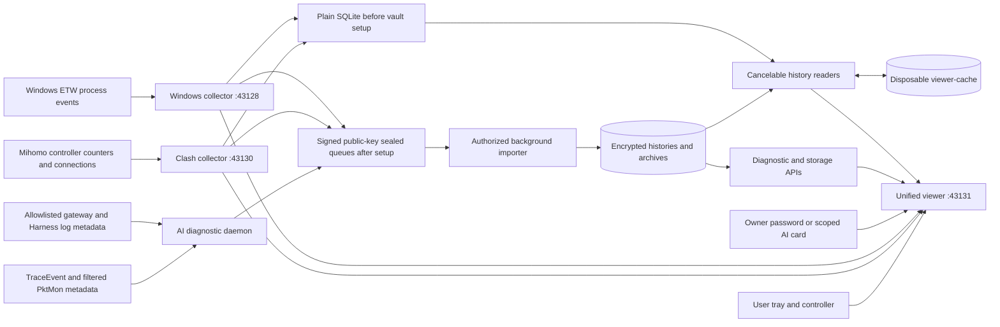

# Architecture and accounting

The two traffic collectors maintain independent Windows and Mihomo histories. Before optional password setup, they append separate plain SQLite databases. After setup, collectors retain only the history public key and seal signed packets into separate persistent queues, including while Windows is locked. The authorized writer opens encrypted history databases and imports bounded rotating batches without holding up the viewer. Migration, backup verification and cleanup are separate resumable steps; installation alone does not encrypt old files. See [VAULT.md](VAULT.md).

The viewer reads history through bounded workers and builds replaceable historical program summaries in `viewer-cache`. Encrypted histories use encrypted summary databases. A cache failure falls back to the original records. The cache preserves connection IDs, interval boundaries and historical attribution; changing an alias does not silently reinterpret previously unidentified traffic as known. Old samples and minute buckets can move into verified lossless archive blocks inside the encrypted database without changing date precision or unlimited retention; [STORAGE.md](STORAGE.md) describes the cache budget and space reclamation.

Quick totals/trends, full attribution and interactive connection details each have an independent worker. A reader executes one query at a time, merges equal requests, bounds queued work, removes canceled subscriptions, and terminates/replaces a worker when active work is abandoned or times out. HTTP/viewer caches and in-memory browser snapshots also have limits. Changing ranges discards late responses; a transient error keeps the last successful same-range display with a status message. A detail click immediately displays its selected time window, clears mismatched old results and offers retry if loading fails. `/api/health` reports worker stages and queue/failure counters without history records.

Charts allocate only the visible high-DPI area. Scrolling changes a logical coordinate space. Hover uses a DOM tooltip instead of repeatedly redrawing all bars. Hidden pages pause refresh work. Program lists use pagination. These choices bound common sources of long-session browser growth; they do not replace multi-day validation.

## Authorization and diagnosis

An owner session lasts at most 12 hours. The browser can retain its temporary token and original expiry across closing/reopening, but must validate it with the server before restoring private views. It stores no password, history key or decrypted history snapshot. Windows lock, logout, explicit lock, expiry and viewer restart invalidate owner access. AI cards independently restrict source, date windows, operation, expiry and lock continuation; restricted queries cannot reuse unrestricted summaries. Each response is checked again before returning results.

The independent diagnostic daemon incrementally reads allowlisted Magpie, CC Switch and Harness log metadata, combines it with bounded TraceEvent/PktMon network evidence, and seals retained incidents and self-checks into the same protected pipeline. Ordinary TCP background stays in bounded memory; retained evidence goes into the encrypted diagnostic database. Incident filters and evidence queries enforce authorized dates. Diagnosis is observational and is not in the gateway's request-forwarding path. See [connection diagnostics](connection-diagnostics.md) for source capabilities and limits.

Optional physical relay bypass is a separate, explicitly configured maintenance task. It manages exact IPv4 routes, a marked hosts block and a Clash enhancement overlay, verifies the chosen physical path and supports rollback. Stopping diagnosis does not itself remove these routes.

## What each counter measures

- **Windows**: ETW TCP/UDP process event bytes, including loopback. Process identity can be missing, buffers can lose events, and native startup requires sufficient privileges.
- **Clash**: a selected Mihomo-compatible controller's global samples and per-connection deltas. A baseline is established on attach/reconnect. Polling can miss short-lived connections and closing bytes. Proxy, DIRECT and unknown routes are classified from retained controller evidence.
- **Harness**: classifications inside those records. Supported process names, limited Node script identity and ancestry provide evidence. Unconfirmed historical identities stay unknown/other. This is not per-chat accounting.

Do not add Windows and Clash totals: application-to-proxy and proxy-to-server legs can be counted separately and the views overlap. Process totals can differ from global counters when attribution is missing. The UI keeps the residual explicit instead of inventing a process. These counters are not network-interface billing totals or VPN provider invoices.

The current overview calendar uses `Asia/Shanghai`. Explicit end boundaries are exclusive. No observations means unknown coverage rather than a fabricated zero. Upload/download bars use orange/blue; gaps and partial coverage have separate markers. Unlimited retention means the collector does not age out history; it also means disk use can grow indefinitely.

The original legacy interfaces and optional session/calendar/report features remain. Their original implementation documentation is archived under `docs/upstream/`.
