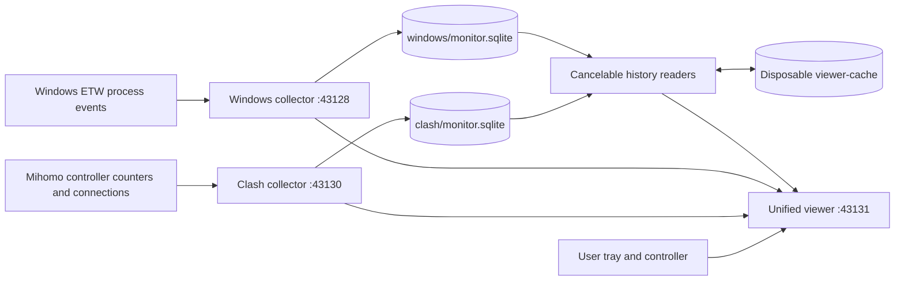

# Architecture and accounting

The two collectors append separate databases. The viewer reads the originals without modifying them and builds replaceable historical program summaries in `viewer-cache`. A cache failure falls back to the original records. The cache preserves connection IDs, interval boundaries and historical attribution; changing an alias does not silently reinterpret previously unidentified traffic as known.

Quick totals/trends and full attribution use separate workers. A reader executes one query at a time, merges equal requests, bounds queued work, removes canceled subscriptions, and terminates/replaces a worker when active work is abandoned or times out. HTTP/viewer caches and browser snapshots also have limits. Changing ranges discards late responses; a transient error keeps the last successful same-range display with a status message.

Charts allocate only the visible high-DPI area. Scrolling changes a logical coordinate space. Hover uses a DOM tooltip instead of repeatedly redrawing all bars. Hidden pages pause refresh work. Program lists use pagination. These choices bound common sources of long-session browser growth; they do not replace multi-day validation.

## What each counter measures

- **Windows**: ETW TCP/UDP process event bytes, including loopback. Process identity can be missing, buffers can lose events, and native startup requires sufficient privileges.
- **Clash**: a selected Mihomo-compatible controller's global samples and per-connection deltas. A baseline is established on attach/reconnect. Polling can miss short-lived connections and closing bytes. Proxy, DIRECT and unknown routes are classified from retained controller evidence.
- **Harness**: classifications inside those records. Supported process names, limited Node script identity and ancestry provide evidence. Unconfirmed historical identities stay unknown/other. This is not per-chat accounting.

Do not add Windows and Clash totals: application-to-proxy and proxy-to-server legs can be counted separately and the views overlap. Process totals can differ from global counters when attribution is missing. The UI keeps the residual explicit instead of inventing a process. These counters are not network-interface billing totals or VPN provider invoices.

The current overview calendar uses `Asia/Shanghai`. Explicit end boundaries are exclusive. No observations means unknown coverage rather than a fabricated zero. Upload/download bars use orange/blue; gaps and partial coverage have separate markers. Unlimited retention means the collector does not age out history; it also means disk use can grow indefinitely.

The original legacy interfaces and optional session/calendar/report features remain. Their original implementation documentation is archived under `docs/upstream/`.
