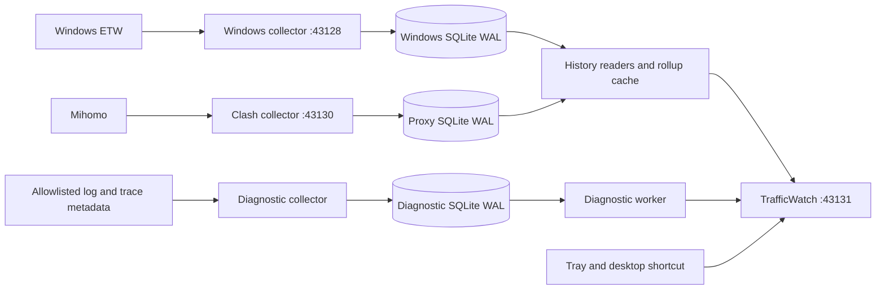

# Architecture and accounting

The collectors write independently to SQLite WAL. The viewer uses separate workers for first-screen totals, full attribution, detail queries and diagnostics. The `history-rollup` summary can be rebuilt from the source tables and preserves exact interval boundaries. The viewer validates loopback requests and has no password or visitor authorization. An offline upgrade utility handles older encrypted files and does not run during collection.

Quick totals/trends, full attribution and interactive connection details each have an independent worker. A reader executes one query at a time, merges equal requests, bounds queued work, removes canceled subscriptions, and terminates/replaces a worker when active work is abandoned or times out. HTTP/viewer caches and in-memory browser snapshots also have limits. Changing ranges discards late responses; a transient error keeps the last successful same-range display with a status message. A detail click immediately displays its selected time window, clears mismatched old results and offers retry if loading fails. `/api/health` reports worker stages and queue/failure counters without history records.

Charts allocate only the visible high-DPI area. Scrolling changes a logical coordinate space. Hover uses a DOM tooltip instead of repeatedly redrawing all bars. Hidden pages pause refresh work. Program lists use pagination. These choices bound common sources of long-session browser growth; they do not replace multi-day validation.

## Diagnosis

The diagnostic daemon records allowlisted gateway and Harness metadata, plus bounded TraceEvent/PktMon evidence. Ordinary TCP background stays in bounded memory, and retained evidence goes to local SQLite. The diagnostic service does not forward user requests. See [connection diagnostics](connection-diagnostics.md).

Optional physical relay bypass is a separate, explicitly configured maintenance task. It manages exact IPv4 routes, a marked hosts block and a Clash enhancement overlay, verifies the chosen physical path and supports rollback. Stopping diagnosis does not itself remove these routes.

## What each counter measures

- **Windows**: ETW TCP/UDP process event bytes, including loopback. Process identity can be missing, buffers can lose events, and native startup requires sufficient privileges.
- **Clash**: a selected Mihomo-compatible controller's global samples and per-connection deltas. A baseline is established on attach/reconnect. Polling can miss short-lived connections and closing bytes. Proxy, DIRECT and unknown routes are classified from retained controller evidence. Automatically identified airports are grouped by their normalized names across clients. The original client and node are available in each airport's details.
- **Harness**: classifications inside those records. Supported process names, limited Node script identity and ancestry provide evidence. Unconfirmed historical identities stay unknown/other. This is not per-chat accounting.

Do not add Windows and Clash totals: application-to-proxy and proxy-to-server legs can be counted separately and the views overlap. Process totals can differ from global counters when attribution is missing. The UI keeps the residual explicit instead of inventing a process. These counters are not network-interface billing totals or VPN provider invoices.

The current overview calendar uses `Asia/Shanghai`. Explicit end boundaries are exclusive. No observations means unknown coverage rather than a fabricated zero. Upload/download bars use orange/blue; gaps and partial coverage have separate markers. Unlimited retention means the collector does not age out history; it also means disk use can grow indefinitely.

The collector's old home page redirects to the overview. Existing session, calendar and report API clients can still use those endpoints on the local collector. The original implementation documentation is archived under `docs/upstream/`.
